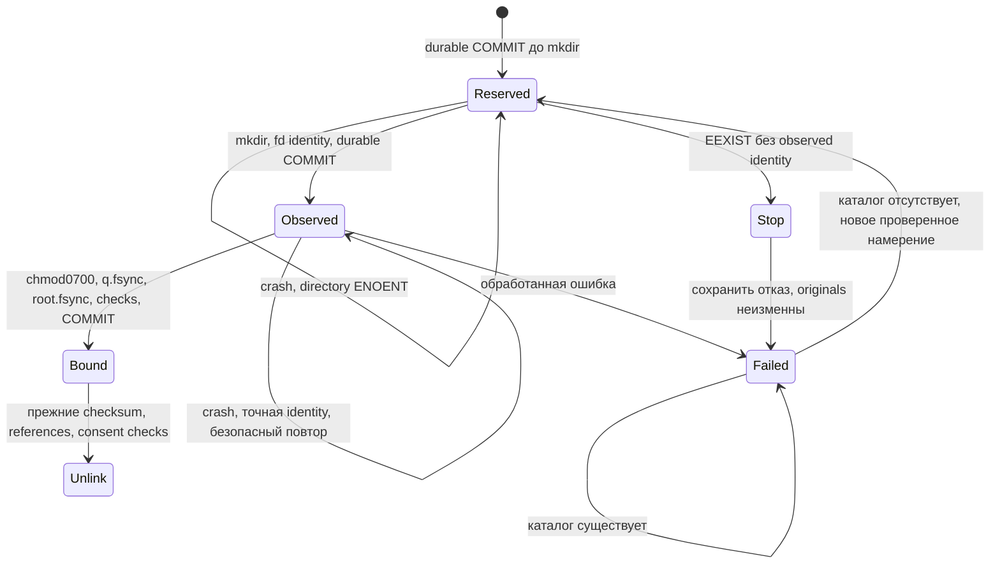

# Build11: NFS Quarantine Crash Recovery — кандидат патча

Production и оригиналы не использовались. APK/Docker/IPA не пересобирались.
Старые release artifacts этого исправления не содержат. Развёртывание этим
документом не разрешается.

## База и границы изменения

Cloud base: `72e668597b1a43a29778397048c622a81a386b71`.
HP snapshot baseline: `92af234687caeca9307aa7d4ea2a51553eecf9cf`.
Второй commit сохраняет **ровно две разницы из архива**: ранее незакоммиченный
Live Photo fix и его тесты. Остальные четыре файла уже совпадали байт в байт.
Финальный standalone patch строится ПОСЛЕ этого baseline и не добавляет Live
Photo fix повторно. Его логика JPG/NAS + MP4/SSD сохраняется; возможны только
форматные изменения прежних строк в repository.

Шесть preimage SHA-256: `BUILD11-NFS-RECOVERY-BASELINE.sha256` рядом с этим файлом.
Два исходных medium spec и NFS helper не изменены патчем. Его новые test helpers
не зависят от путей Cloud checkout или секретов HP.

## Протокол

Имя `.gallery-deletion-quarantine` остаётся фиксированным. В существующем JSONB
policy.rootIdentities и receipt.files.rootIdentity добавлено необязательное поле
quarantineIntent: UUID, state, затем observed identity и исходный full stat mode.
Новых таблиц/колонок/миграций нет. Намерение связано с проверенными root, owner,
scope и receipt существующими серверными записями. Это доверенное состояние БД,
а не клиентский recovery-proof. Входной journal от клиента отбрасывается;
проверка Ed25519 recovery evidence и owner consent не ослабляется.



На dedicated Kysely connection удерживаются session advisory locks:
`hashtextextended('gallery-quarantine-binding-v1',733)`, затем owner lock731.
Они охватывают отдельные COMMIT и сериализуют также разные owner/алиасы roots.
Глобальная сериализация затрагивает binding phase, не заменяет существующие
owner/path locks, проверки ссылок и receipt при unlink. Все journal-транзакции
устанавливают `SET LOCAL synchronous_commit='on'`. PostgreSQL должен реально
работать с fsync/full_page_writes=on и штатной надёжной storage/WAL.
Transaction-pooling proxy между connection и PG session не поддерживается.

Новый каталог открывается через fd-anchored path с O_DIRECTORY|O_NOFOLLOW.
Observed inode/device/UID/GID/mount identity и mode фиксируются **до chmod**.
На NFS учитываются реальные mapped 1024:100, а не process UID 0. Затем повторяются
fd-chmod0700, проверки namespace/identity, пустоты, q.fsync и root.fsync.
BOUND сохраняется одновременно в policy/receipt до capture любого оригинала.
Motion SSD root не добавляется в полномочия всей внешней библиотеки: его intent
сохраняется в том receipt, где уже проверены unique same-owner Live Photo child
и точный owner-scoped MP4 path.

Recovery OBSERVED требует точного inode/device/UID/GID/mount и исходного mode
либо 0700. Состояние 0700 не считается доказательством прошедшего fsync: оба sync
повторяются. Existing BOUND identities используют прежний путь, без повторного
chmod. Захват UUID-файла, checksum, lost rename/unlink ACK и окончательные
receipts/tombstones работают как раньше.

## Crash windows и отказы

| Момент                                          | Результат следующей попытки                                                      |
| ----------------------------------------------- | -------------------------------------------------------------------------------- |
| До COMMIT Reserved                              | Никаких FS изменений; новое намерение                                            |
| После Reserved, до mkdir                        | ENOENT допускает создание под сохранённым intent                                 |
| После mkdir, до COMMIT Observed                 | **STOP**; UUID/имя/UID/пустота не доказывают принадлежность                      |
| После Observed, до/после chmod                  | Только exact identity retry; никаких originals до полного securing               |
| После каждого directory fsync, до BOUND         | Повторить securing и оба sync, затем COMMIT                                      |
| После BOUND, до/во время rename/unlink          | Прежний persisted receipt и проверяемый retry                                    |
| Ошибка chmod/fsync                              | Failed, без автоматического ремонта существующего каталога                       |
| Failed и qpath отсутствует                      | Новый UUID + durable Reserved; mkdir по-прежнему атомарно отвергает EEXIST       |
| Любая подмена inode/UID/GID/mount/mode, symlink | Отказ; не принимать/не удалять подмену                                           |
| Отзыв owner consent                             | Проверки до Reserved, Observed, BOUND и перед unlink запрещают destructive phase |

Неустранимое окно mkdir→observed COMMIT оставлено fail-closed намеренно: Node/NFS
не предоставляет атомарный DB+mkdir commit или аутентифицированный inode из
предварительного UUID. Автоматическое усыновление orphan было бы обходом защиты.
Рестарт процесса поддержан; remount/recreated container с изменённой незавершённой
mount identity требует нового operator review, не молчаливого rebinding.

## Воспроизводимые проверки

В предоставленных двух исходных spec реально обнаружено **96**, не 99 тестов:
baseline 96 PASS / 0 FAIL / 0 SKIP. Файлы не исправлялись ради результата. Утверждение
99/99 по данному архиву не подтверждается. Новые реальные fault tests отдельно
запускают worker, проверяют его process group и завершают SIGKILL. PostgreSQL
commit проверяется из другого соединения и нового AssetRepository.

Команды из server/, Node24.21.0, Vitest4.1.11; pinned disposable PostgreSQL14:
`ghcr.io/immich-app/postgres:14-vectorchord0.4.3@sha256:dbf18b3ffea4a81434c65b71e20d27203baf903a0275f4341e4c16dfd901fd67`.
Использовать только отдельный тестовый Docker daemon, не production PostgreSQL
или NAS mounts. Medium globalSetup всегда создаёт новый контейнер и clone DB.
Не задавать production credentials/URL. Ryuk очищает только свои test containers.

```bash
./node_modules/.bin/tsc --noEmit -p tsconfig.json
./node_modules/.bin/eslint src/utils/authorized-deletion.ts \
  src/repositories/asset.repository.ts src/schema/tables/asset-deletion.table.ts \
  test/medium/globalSetup.ts test/medium/specs/services/nfs-quarantine-recovery.spec.ts \
  test/medium/quarantine-crash.worker.ts --max-warnings 0
GALLERY_TEST_DURABLE_POSTGRES=1 ./node_modules/.bin/vitest run \
  --config test/vitest.config.medium.mjs \
  test/medium/specs/services/authorized-deletion.spec.ts \
  test/medium/specs/services/build11-storage-deletion-lifecycle.spec.ts \
  test/medium/specs/services/nfs-quarantine-recovery.spec.ts --reporter=dot
./node_modules/.bin/vitest run --config test/vitest.config.mjs \
  src/utils/authorized-deletion.spec.ts src/utils/deletion-recovery.spec.ts --reporter=dot
```

Флаг durability включает и SQL-проверяет fsync/full_page_writes/synchronous_commit
**on** до миграций; без флага прежние unrelated medium defaults не меняются.
Это позволяет повторить проверку без временных Cloud configs. SQL миграции
исполнялись исключительно на новой disposable PG. Итоговые counts и hashes
логов прилагаются в report; тесты с реальным Synology NFS не выполнялись.
NFS helper эмулирует metadata/root squash, но chmod/rename/fsync/hash/unlink
выполняются на настоящих disposable файлах Linux.

Ранний прототип fault harness с pg_terminate_backend не был принят: драйвер
postgres.js выдавал uncaught ошибки при повторных запросах через оборванную
reserved connection. Он заменён настоящим SIGKILL worker; этот прототип не
входит в patch и не считается подтверждением application failure/PASS.

## Применение только в тестовом HP worktree

Оператор codex-gallery; Node в PATH как в приложенном task. Сохранить все
существующие uncommitted изменения, ничего не reset/checkout поверх них.
Из корня нужной тестовой копии:

```bash
set -euo pipefail
PATCH=/absolute/path/gallery-build11-nfs-recovery-FINAL.patch
# BASELINE — копия приложенного к патчу checksum-файла, доступная ДО применения.
BASELINE=/absolute/path/BUILD11-NFS-RECOVERY-BASELINE.sha256
sha256sum -c --strict "$BASELINE"
git apply --check "$PATCH"
git apply "$PATCH"
git diff --check
```

При несовпадении любого preimage **STOP**: не применять force/3way/unsafe-paths,
не заменять файл целиком и не терять Live Photo fix. Для другой базы требуется
отдельная проверка diff. Это не команда обновления running container.

После применения запустить команды выше на disposable DB/media. Smoke должен
подтвердить NAS/JPG+SSD/MP4 pair, exact scope, receipt complete и отказ на foreign
EEXIST. Не использовать реальные семейные фото. Патч и baseline-файл не требуют
подписывающих ключей Android/iOS; API, authentication и deletion consent не меняются.

## Ручное recovery неоднозначного orphan, только после отдельного разрешения

1. Через штатный owner consent отключить permanent deletion затронутого scope;
   дождаться подтверждённого отзыва и отсутствия выполняющейся операции этого
   scope. Не активировать legacy jobs/retention и не останавливать чужие services.
2. Сохранить private backup/evidence policy, receipt, root identity и snapshot
   каталога. Сверить originals/checksums и отсутствие files-removed/complete.
   Если каталог непустой, потеряны originals или есть конфликт receipts — STOP,
   отдельное расследование/восстановление, не выполнять дальнейший обычный retry.
3. После отдельного согласования filesystem maintenance сохранить проблемный
   **пустой** каталог посредством rename в пределах той же файловой системы,
   в forensic location вне всех library import roots, сохраняя inode/UID/GID/права.
   Если подходящего места или прав нет — STOP. Не выполнять cross-filesystem
   copy+delete; не удалять его и не делать chmod для усыновления.
   На Synology использовать разрешённую оператору операцию NAS, без расширения
   NFS exports/permissions. Патч сам эту операцию не выполняет.
4. Убедиться в отсутствии активного fixed qpath и неизменности root identity.
   Через обычный интерфейс владельца вновь дать consent с актуальными
   prerequisites. Никаких SQL reset, фиктивной identity или обновления timestamps.
5. Нормальный retry создаст новый UUID/Reserved, новый каталог и новое проверенное
   binding. Если кто-либо создаст qpath в промежутке — снова EEXIST/STOP.
   Сначала acceptance только на disposable media. Forensic evidence не удалять.

Без этих условий оставлять fail-closed. Существующий зарегистрированный BOUND
каталог нельзя сбрасывать по данной процедуре, даже если он исчез: нужна отдельная
recovery проверка. Нельзя переносить непустой quarantine как способ забыть originals.

## Откат

В тестовой копии, сохранив новые изменения и результаты:

```bash
git apply --reverse --check "$PATCH"
git apply --reverse "$PATCH"
```

Откатываются только изменения recovery patch; исходный HP Live Photo fix остаётся.
Нельзя reverse применять поверх последующих изменений без проверки. Миграции
не нужны, JSON journal не удалять/переписывать. Старый runtime не обеспечивает
новое crash recovery; перед любым отдельным production rollback отключить
permanent deletion через owner consent и сохранить согласованный backup/evidence.
Code rollback не восстанавливает уже удалённые файлы и не откатывает FS/DB.
Production upgrade/rollback, real NFS validation, очистка forensic evidence и
удаление настоящих originals требуют отдельных решений владельца.

## Итог проверки и оставшиеся границы

Финальный совместный запуск: **113 PASS / 0 FAIL / 0 SKIP** = 96 исходных +
17 новых medium tests. Два utility unit suites: **165 PASS / 0 FAIL / 0 SKIP**.
TypeScript, scoped ESLint и Prettier прошли. Подробный отчёт и hashes:
`BUILD11-NFS-RECOVERY-TEST-RESULTS.json` рядом с этим документом.

Существующие Live Photo split-root regression cases прошли без изменений.
При чтении HP baseline найдено отдельное существующее ограничение: binding
SSD-root хранится в конкретном child receipt; другое Live Photo того же owner
с новым receipt может получить unregistered EEXIST на том же encoded-video root.
Эта последовательность **не воспроизводилась отдельным runtime-тестом** в этой
задаче и этим recovery patch не исправляется. Не считать проверенные одиночные
пары доказательством неограниченного повторного удаления разных Live Photos.

Реальный Synology NFSv3, power loss PostgreSQL/NAS, physical Android/iOS и
production deployment **NOT TESTED**. SIGKILL проверяет аварии приложения;
включённые fsync/WAL не заменяют испытания отключения питания аппаратуры.
Кандидат готов для проверки на изолированном HP/NFS fixture, но не объявляется
полностью production-ready. Файловая система без требуемых chmod/fsync остаётся
fail-closed; нельзя отключать проверки для получения PASS.
