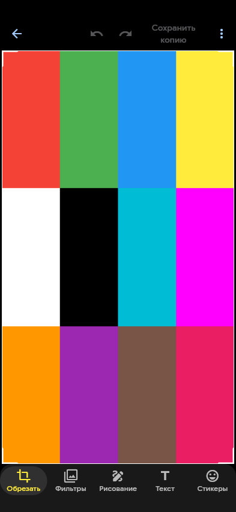
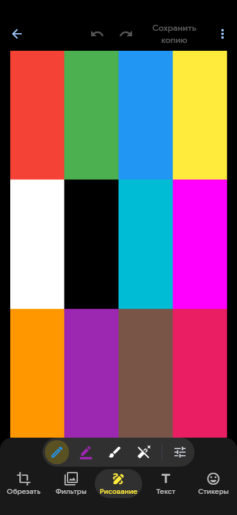
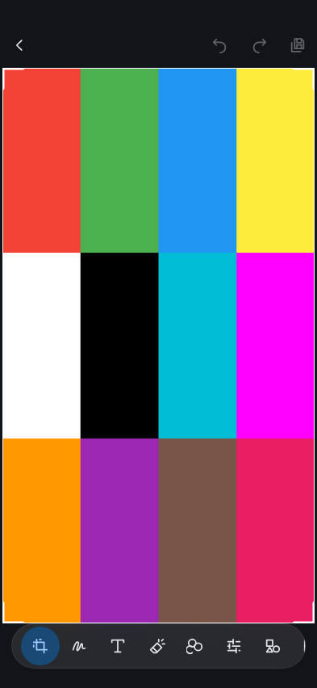
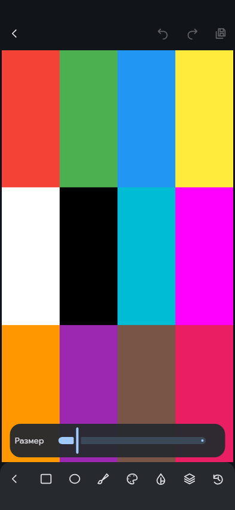
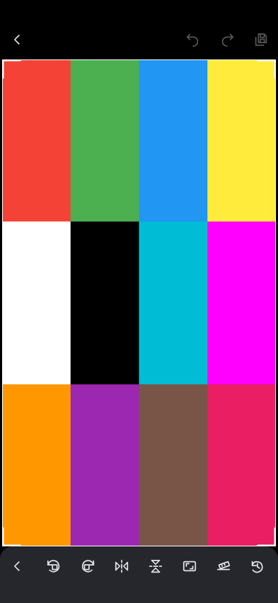

# Сравнение редактора FOTO — раздел 12

Источник новых снимков: `dee6fcda8becb4a9ad304aca69ea5bd97ef0debe`. Это реальный Flutter widget render синтетической фотографии при **393 × 852 dp**, DPR 1, SafeArea 28/24 dp. Это **не снимки Samsung**. Дизайн иконок: **ICON DESIGN APPROVAL PENDING**.

[Открыть лист сравнения](comparison.html) · [Машинный отчёт измерений](measurements.json)

## До изменения

Архивные golden-файлы доступны в дереве `b61867889`; тот же размер экрана и синтетическая фотография. Они показывают прежнюю компоновку, не аппаратную приёмку.

| Вход                                                                              | Разметка                                                                                   |
| --------------------------------------------------------------------------------- | ------------------------------------------------------------------------------------------ |
|  |  |

## После изменения

| Состояние                                                                       | Область фотографии, dp | Изображение, dp | Док с SafeArea, dp |
| ------------------------------------------------------------------------------- | ---------------------- | --------------- | ------------------ |
| [Вход в редактор](../../../mobile/test/pages/edit/goldens/fixed_dock_entry.png) | 393 × 688              | 387 × 688       | 393 × 80           |
| [Разметка](../../../mobile/test/pages/edit/goldens/fixed_dock_markup.png)       | 393 × 688              | 387 × 688       | 393 × 80           |
| [Маркер](../../../mobile/test/pages/edit/goldens/fixed_dock_marker.png)         | 393 × 688              | 387 × 688       | 393 × 80           |
| [Толщина](../../../mobile/test/pages/edit/goldens/fixed_dock_width.png)         | 393 × 688              | 387 × 688       | 393 × 80           |
| [Цвет](../../../mobile/test/pages/edit/goldens/fixed_dock_color.png)            | 393 × 688              | 387 × 688       | 393 × 80           |
| [Обрезка](../../../mobile/test/pages/edit/goldens/fixed_dock_crop.png)          | 393 × 688              | 387 × 688       | 393 × 80           |
| [Текст](../../../mobile/test/pages/edit/goldens/fixed_dock_text.png)            | 393 × 688              | 387 × 688       | 393 × 80           |

Панель управления: **56 dp**; нижний системный отступ: **24 dp**. Вход, категория, инструмент и параметры сохраняют один прямоугольник viewport. Временная палитра/ползунок накладываются поверх него и закрываются, не добавляя ряд в основной layout.

## Снимки разных уровней

| Вход                                                                  | Разметка                                                                   | Маркер                                                                   |
| --------------------------------------------------------------------- | -------------------------------------------------------------------------- | ------------------------------------------------------------------------ |
|  |  |  |

| Толщина                                                                  | Цвет                                                                  | Обрезка                                                                 |
| ------------------------------------------------------------------------ | --------------------------------------------------------------------- | ----------------------------------------------------------------------- |
|  |  |  |

[Снимок режима «Текст»](../../../mobile/test/pages/edit/goldens/fixed_dock_text.png).

## Незавершённая аппаратная приёмка

Samsung: одинаковая реальная фотография до/после, вложенные инструменты, landscape, клавиатура, Save Copy/Cancel, TalkBack, 120 Гц (profile UI/raster frame times). Live Photo: холодный запуск и все восемь сценариев PR16 с реальным движением и единственным проигрывателем. Сам факт прохождения golden/widget tests аппаратную приёмку не заменяет.

Merge, deployment и release не выполнялись.
