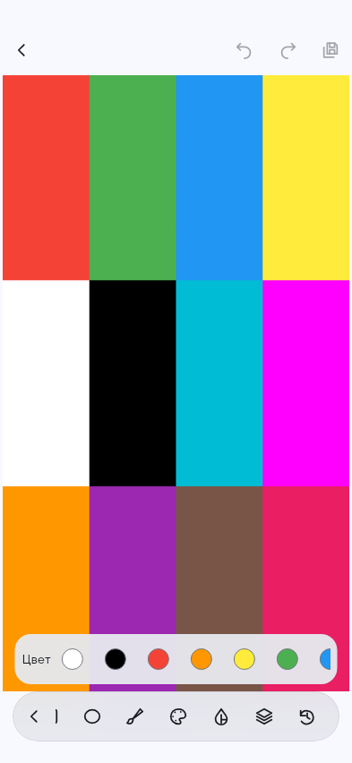
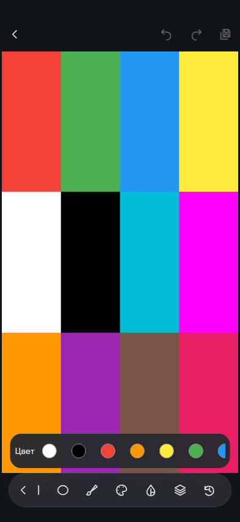

# Сравнение редактора FOTO — раздел 12

Источник новых снимков: `65c99a6fae530715ca9c2bc8189d941dcc734942`. Это реальный Flutter widget render синтетической фотографии при **393 × 852 dp**, DPR 1, SafeArea 28/24 dp. Это **не снимки Samsung**. Дизайн иконок: **FOTO v1 APPROVED пользователем (ccdb8a892)**.

[Открыть лист сравнения](comparison.html) · [Машинный отчёт измерений](measurements.json)

## До изменения

Архивные golden-файлы доступны в дереве `b61867889`; тот же размер экрана и синтетическая фотография. Они показывают прежнюю компоновку, не аппаратную приёмку.

| Вход                                                                              | Разметка                                                                                   |
| --------------------------------------------------------------------------------- | ------------------------------------------------------------------------------------------ |
|  |  |

## После изменения

| Состояние                                                                       | Область фотографии, dp | Изображение, dp | Док с SafeArea, dp |
| ------------------------------------------------------------------------------- | ---------------------- | --------------- | ------------------ |
| [Вход в редактор](../../../mobile/test/pages/edit/goldens/fixed_dock_entry.png) | 393 × 688              | 387 × 688       | 393 × 80           |
| [Разметка](../../../mobile/test/pages/edit/goldens/fixed_dock_markup.png)       | 393 × 688              | 387 × 688       | 393 × 80           |
| [Маркер](../../../mobile/test/pages/edit/goldens/fixed_dock_marker.png)         | 393 × 688              | 387 × 688       | 393 × 80           |
| [Толщина](../../../mobile/test/pages/edit/goldens/fixed_dock_width.png)         | 393 × 688              | 387 × 688       | 393 × 80           |
| [Цвет](../../../mobile/test/pages/edit/goldens/fixed_dock_color.png)            | 393 × 688              | 387 × 688       | 393 × 80           |
| [Обрезка](../../../mobile/test/pages/edit/goldens/fixed_dock_crop.png)          | 393 × 688              | 387 × 688       | 393 × 80           |
| [Текст](../../../mobile/test/pages/edit/goldens/fixed_dock_text.png)            | 393 × 688              | 387 × 688       | 393 × 80           |

Панель управления: **56 dp**; нижний системный отступ: **24 dp**. Вход, категория, инструмент и параметры сохраняют один прямоугольник viewport. Временная палитра/ползунок накладываются поверх него и закрываются, не добавляя ряд в основной layout.

## Снимки разных уровней

| Вход                                                                  | Разметка                                                                   | Маркер                                                                   |
| --------------------------------------------------------------------- | -------------------------------------------------------------------------- | ------------------------------------------------------------------------ |
|  |  |  |

| Толщина                                                                  | Цвет                                                                  | Обрезка                                                                 |
| ------------------------------------------------------------------------ | --------------------------------------------------------------------- | ----------------------------------------------------------------------- |
|  |  |  |

[Снимок режима «Текст»](../../../mobile/test/pages/edit/goldens/fixed_dock_text.png).

## Светлая и тёмная темы

[Source-bound render CI](https://github.com/docice545/gallery/actions/runs/41777329400/job/126400954483) PASS. Снимки зафиксированы в `fb1a5bc87e3da8a53cfe4f8924596b22d4b78fca`, source SHA указан выше и в measurements.json. Каждый ряд снят **с одного открытого редактора**, меняется только системная тема при FOTO system. Инструмент, viewport и изображение одинаковы; тема не применяется к пикселям фотографии. Отдельный тест проверяет одинаковый PNG export после реальных рисования и zoom/pan, сохранение undo/redo, explicit light/dark overrides и читаемость нормальных/активных/деструктивных состояний на обоих фонах.

| Состояние | Светлая | Тёмная |
|---|---|---|
| Вход | [PNG](../../../mobile/test/pages/edit/goldens/fixed_dock_theme_light_entry.png) | [PNG](../../../mobile/test/pages/edit/goldens/fixed_dock_theme_dark_entry.png) |
| Разметка | [PNG](../../../mobile/test/pages/edit/goldens/fixed_dock_theme_light_markup.png) | [PNG](../../../mobile/test/pages/edit/goldens/fixed_dock_theme_dark_markup.png) |
| Маркер | [PNG](../../../mobile/test/pages/edit/goldens/fixed_dock_theme_light_marker.png) | [PNG](../../../mobile/test/pages/edit/goldens/fixed_dock_theme_dark_marker.png) |
| Толщина | [PNG](../../../mobile/test/pages/edit/goldens/fixed_dock_theme_light_width.png) | [PNG](../../../mobile/test/pages/edit/goldens/fixed_dock_theme_dark_width.png) |
| Цвет | [PNG](../../../mobile/test/pages/edit/goldens/fixed_dock_theme_light_color.png) | [PNG](../../../mobile/test/pages/edit/goldens/fixed_dock_theme_dark_color.png) |
| Обрезка | [PNG](../../../mobile/test/pages/edit/goldens/fixed_dock_theme_light_crop.png) | [PNG](../../../mobile/test/pages/edit/goldens/fixed_dock_theme_dark_crop.png) |
| Текст | [PNG](../../../mobile/test/pages/edit/goldens/fixed_dock_theme_light_text.png) | [PNG](../../../mobile/test/pages/edit/goldens/fixed_dock_theme_dark_text.png) |

| Палитра в светлой теме | То же состояние в тёмной теме |
|---|---|
|  |  |

## Незавершённая аппаратная приёмка

Samsung: одинаковая реальная фотография до/после, вложенные инструменты, landscape, клавиатура, Save Copy/Cancel, TalkBack, 120 Гц (profile UI/raster frame times). Live Photo: холодный запуск и все восемь сценариев PR16 с реальным движением и единственным проигрывателем. Сам факт прохождения golden/widget tests аппаратную приёмку не заменяет.

Merge, deployment и release не выполнялись.
