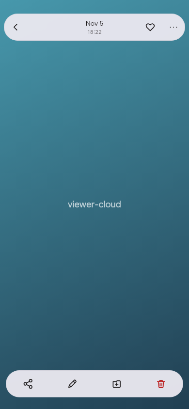
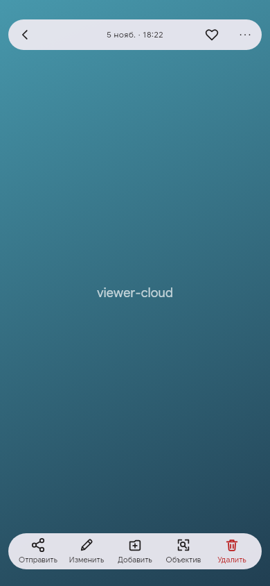
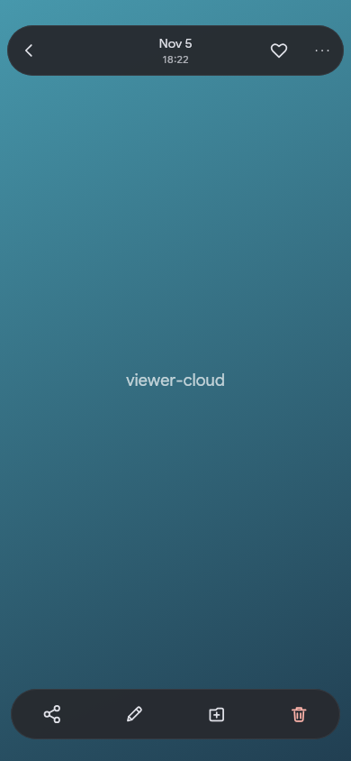
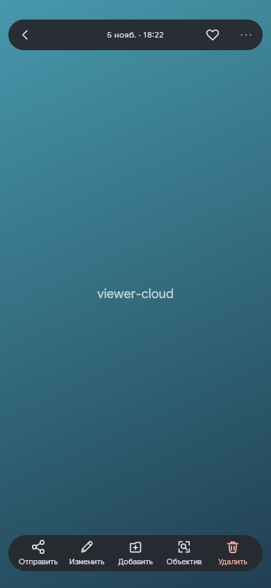
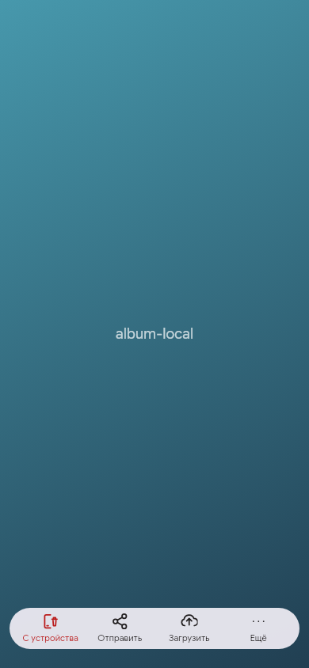
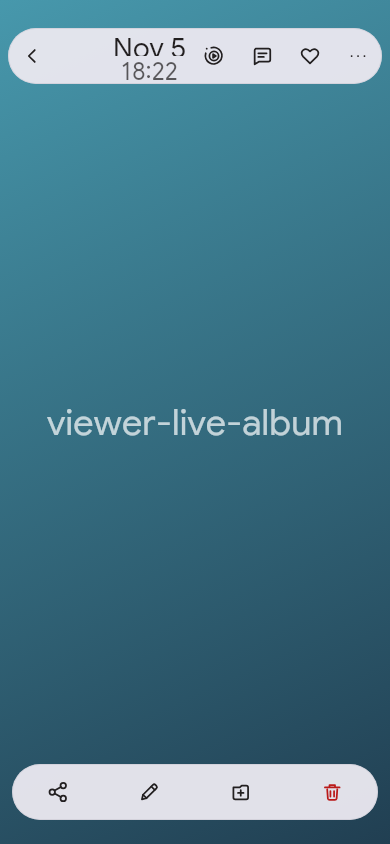
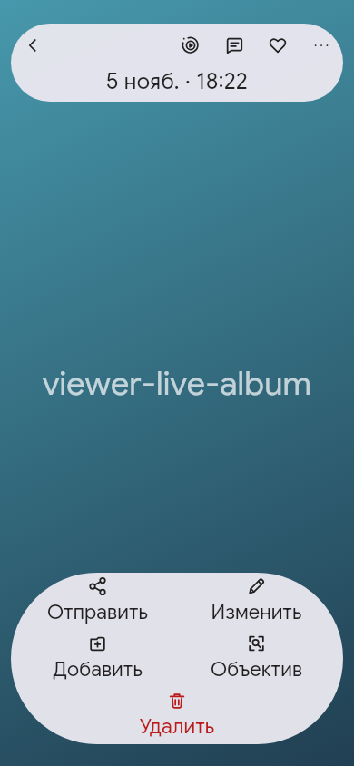
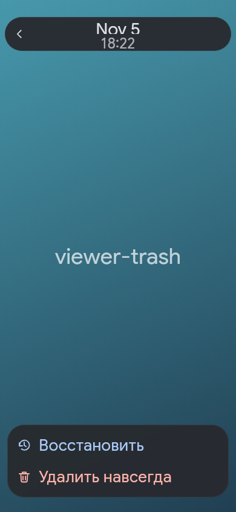
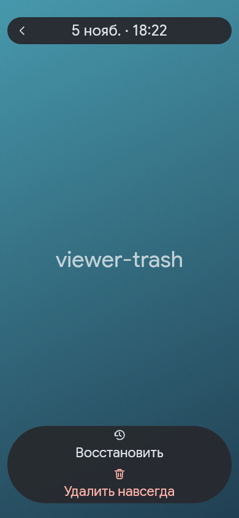

# Flutter render comparison

Actual production widgets rendered by `flutter_test`, 390×844 dp. The gradient is a deliberate fixture background; these are not Samsung captures. The same real components, providers, localization, fonts and actions are used before and after. No generated mockups or edited screenshots.

Baseline: `3678203a4d12972ddce6871cc343b4e181b96881`. All 54 baseline renders completed. New behavior/geometry assertions are disabled only in the explicitly labelled baseline run. Current-source acceptance runs them enabled. Full 54 pairs: [before](before/) / [after](after/).

## Cloud photo / light / 100%

| Before | After |
| --- | --- |
|  |  |

## Cloud photo / dark / 100%

| Before | After |
| --- | --- |
|  |  |

## Device album / light / 100%

| Before | After |
| --- | --- |
|  |  |

## FOTO album / dark / 100%

| Before | After |
| --- | --- |
|  |  |

## Shared album Live Photo / light / 200%

| Before | After |
| --- | --- |
|  |  |

## Trash viewer / dark / 200%

| Before | After |
| --- | --- |
|  |  |
